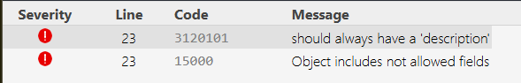
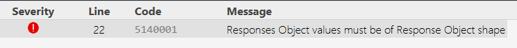

## Hari Senin

1. Buka editor.swagger.io. Tempel contoh YAML "dokumen paling kecil" di atas.
Amati panel kanan. Lalu rusakkan sengaja (hapus 'description' pada salah satu response,
atau ubah indentasi) dan catat pesan error yang muncul. Tulis 3 temuanmu.

2. Anotasi GET /health dan GET /health/ready. Untuk ready, dokumentasikan DUA respons:
200 (database up) dan 503 (database down). Buktikan keduanya dengan Try it out
(matikan PostgreSQL sebentar untuk memancing 503).

### /health 200

### /health/ready 200

### /health/ready 503

3. Buka /api/docs.json. Temukan bagian info, servers, tags, dan paths.
   Jelaskan dengan bahasamu: apa hubungan JSON ini dengan halaman yang tampil di /api/docs?

/api/docs.json adalah spesifikasi mentah (data) hasil generate dari anotasi. /api/docs adalah Swagger UI, yang membaca JSON itu lalu menampilkannya jadi halaman interaktif. Ubah JSON-nya, maka tampilan halamannya ikut berubah.

4. Matikan CSP-bypass (pasang helmet global sebelum docs) dan lihat apa yang terjadi di
   browsermu. Catat gejalanya, lalu kembalikan ke urutan yang benar.

Header Content-Security-Policy muncul, jadi helmet() global memang aktif sebelum docs. dan Di versi swagger-ui-express yang saya pakai, halaman tetap tampil normal dan tidak ada error CSP di Console.

